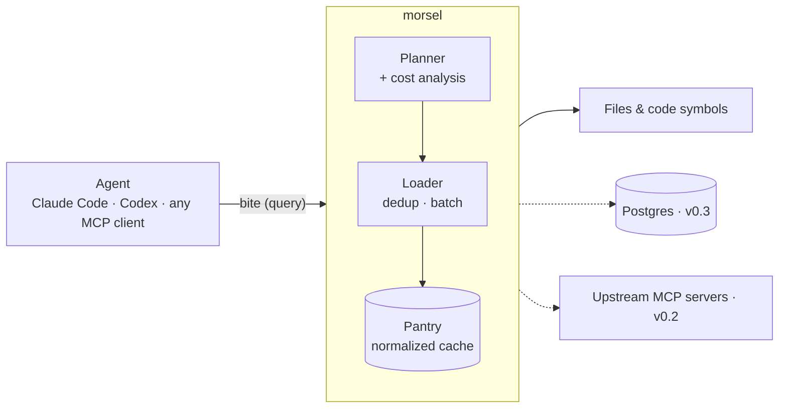

<p align="center">
  <picture>
    <source media="(prefers-color-scheme: dark)" srcset="assets/morsel-logo-dark.svg">
    
  </picture>
</p>

<h3 align="center">Feed your agents morsels, not feasts.</h3>

<p align="center">
  A context engine for AI agents, inspired by the client side of GraphQL.<br>
  Agents query exactly what they need. Nothing enters the context window twice.<br>
  Every response has a token price tag before it is served.
</p>

<p align="center">
  
  
  
  
</p>

---

> **🚧 Pre-alpha.** Morsel is in its spec-driven design phase. The specs in [`specs/`](specs/) are the source of truth, and the code follows them. Star or watch the repo to follow along. Nothing below is a benchmark claim yet: every number we publish will come with a reproducible harness.

## The problem

Agents don't fail because models are weak. They fail, and get expensive, because of **what we feed them**:

- **Over-fetching.** A tool returns an 80 KB object when the agent needed two fields.
- **Re-feeding.** The same file, schema, or issue is pasted into the context again and again, and every agent turn re-bills the whole history.
- **Multiplying.** Three subagents read the same five files. You pay three times.
- **Flying blind.** Nobody knows what a tool call will cost *before* it lands in the context.

Server-side tools (GraphQL MCP servers, response trimmers, schema compressors) fix part of the first bullet, **for one API at a time**.

The other three bullets were solved years ago, for front-ends, by the **client** side of GraphQL: Apollo Client's normalized cache, Relay's fragments, DataLoader's dedup and batching, and query cost analysis. Morsel brings that client side to agents.

## How it works



Morsel runs as a single MCP server. Your agent sees **one graph** over everything it can touch: files, code symbols, database tables, and the tools of your other MCP servers. It queries that graph with a GraphQL selection set, which we call a **bite**:

```graphql
query @budget(tokens: 4000) {
  symbol(name: "CreateOrder", in: "internal/orders") {
    signature
    doc
    callers { approx items { name line } }
  }
  file(path: "internal/orders/service.go") {
    outline { name kind line }
    lines(from: 40, to: 72)
  }
  # coming next: table(name: "orders") { … } and tool(server: "github", …) { … }
}
```

Morsel answers with a compact envelope:

```json
{
  "data": { "...": "only the fields you asked for" },
  "cost": { "est": 1840, "act": 1792, "budget": 4000, "saved": 6310 },
  "crumbs": ["sym:go:internal/orders.CreateOrder#doc"]
}
```

- **`cost`**: what the response weighs in tokens, estimated *before* execution (`est`) and measured after it (`act`). If a bite would exceed its budget, Morsel shortens it, paginates it, or trims it and lists what was cut in `truncated`, instead of flooding the context. `saved` is an estimate against naive whole-file reads.
- **`crumbs`**: fields this agent already received at the same version. Morsel sends a short reference `{"$crumb", "v", "d"}` instead of repeating the content, and the agent can call `morsel_expand` if it lost it.

## Core ideas

| From the GraphQL world | In Morsel | What it saves |
|---|---|---|
| Field selection | **Bites**: ask for `signature`, not the whole file | Over-fetching |
| Normalized cache (Apollo Client) | **Pantry**: every entity is stored once, by ID and version | Re-feeding |
| DataLoader | **Loader**: identical reads from parallel subagents collapse into one | Duplicate upstream work |
| Query cost analysis | **Plate**: a token budget enforced *before* data enters the context | Surprise bills |
| `@defer` | **Brief first**: a summary now, details on `expand` | Speculative reads |
| Persisted queries | **Recipes**: named, reusable bites with stable output, friendly to prompt caching | Prompt churn |

## Quickstart (planned API)

```bash
go install github.com/morsel-dev/morsel/cmd/morsel@latest

morsel init                        # writes morsel.toml + an agent instructions snippet
claude mcp add morsel -- morsel serve
morsel stats                       # tokens served vs. naive baseline, per session
```

```toml
# morsel.toml
[sources.fs]
root = "."

[budget]
default_tokens = 4000
max_tokens = 16000

[crumbs]
ttl = "30m"
max_queries = 40

# v0.2+
# [[upstream]]
# name = "github"
# command = "github-mcp-server"
# args = ["stdio"]

# v0.3+
# [sources.postgres]
# dsn = "${DATABASE_URL}"
```

The agent gets **three tools**, not hundreds: `morsel_query`, `morsel_schema`, and `morsel_expand`.

## How Morsel compares

Morsel stands on the shoulders of existing tools, and it is designed to sit **in front of** them.

| | GraphQL MCP servers (Apollo, WunderGraph, Grafbase) | Response trimmers / schema compressors | Data agents (e.g. PromptQL) | **Morsel** |
|---|---|---|---|---|
| Field selection | ✅ one GraphQL API | ✅ static rules | ✅ | ✅ across all sources |
| Cache across turns, deduplicated by entity | — | — | partial | ✅ |
| Dedup across subagents | — | — | — | ✅ |
| Token cost known *before* serving | — | — | — | ✅ |
| Works with any agent, no vendor | ✅ | ✅ | ✅ (needs Hasura DDN) | ✅ single binary |
| Code-aware (files, symbols) | — | — | — | ✅ |

## Roadmap

- **v0.1 "first bite"**: MCP server, files and Go symbols, bites, budgets, crumbs, `morsel stats`, and the first A/B benchmark (it decides whether the thesis holds)
- **v0.2 "pantry"**: upstream MCP proxying with projection (typed via `outputSchema`, or masks), a persistent cache
- **v0.3 "kitchen"**: Postgres source, multi-language symbols (tree-sitter), recipes
- **v0.4 "table for many"**: an HTTP daemon shared across agents and sessions, cross-agent dedup, a public benchmark harness

The full plan is in [`specs/`](specs/). The ideas behind it are explained in [`docs/VISION.md`](docs/VISION.md). Design docs are currently written in Brazilian Portuguese; English translations will land before v0.1.

## Vocabulary

| Term | Meaning |
|---|---|
| **bite** | A query: a selection set over the graph |
| **plate** | The token budget for a bite or a session |
| **pantry** | The normalized entity cache |
| **crumb** | A short reference to an entity the agent already holds |
| **recipe** | A named, persisted bite |

## Contributing

Morsel is built **spec-first**. Read [`specs/constitution.md`](specs/constitution.md) before opening a PR, and reference the requirement IDs (`FR-xxx`) your change implements. Proposals for new behavior start as a spec change, not as code.

## License

Apache-2.0
