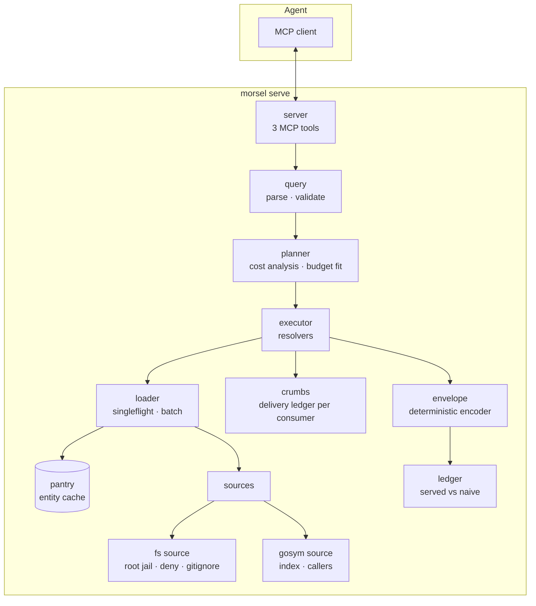

# Plano de implementação 001: MVP "first bite" (v0.1)

**Spec:** [`spec.md`](spec.md) · **Research:** [`research.md`](research.md) · **Contratos:** [`contracts/`](contracts/)

---

## 1. Contexto técnico

| Item | Escolha |
|---|---|
| Linguagem | Go 1.25+ |
| Build | `CGO_ENABLED=0`, binário estático, `goreleaser` para linux, darwin e windows (amd64 e arm64) |
| Protocolo | MCP via `modelcontextprotocol/go-sdk`, transporte stdio |
| Consulta | GraphQL (subconjunto), `vektah/gqlparser/v2` + executor próprio |
| Código Go | `go/parser`, `go/ast`, `go/token` |
| Hash | `cespare/xxhash/v2` |
| Concorrência | `golang.org/x/sync/singleflight`, `errgroup` |
| Glob | `bmatcuk/doublestar/v4` |
| Gitignore | `sabhiram/go-gitignore` (ou implementação própria mínima) |
| Config | `BurntSushi/toml` |
| CLI | `spf13/cobra` |
| Testes | `testing`, golden files, `testscript` (rogpeppe/go-internal) para a CLI, fuzz nativo do Go no parser |

## 2. Constitution Check

| Princípio | Como o plano atende | Exceção? |
|---|---|---|
| I. Contexto escasso | Seleção de campos, `@brief`, crumbs e envelope mínimo | Não |
| II. Custo visível | Estimador antes da materialização, envelope `cost`, `over_budget` com detalhamento | Não |
| III. Seguro por padrão | Confinamento à raiz (`fs.Root`), lista de negação, `.gitignore`, sem escrita e sem rede | Não |
| IV. Neutro | MCP puro. O snippet de instruções é texto genérico | Não |
| V. Binário único | Sem cgo; dependências pequenas, todas em Go puro | Não |
| VI. Determinismo | Serializador com ordem fixa; listas ordenadas por chave documentada | Não |
| VII. Medir | `bench/` e `morsel bench` fazem parte do MVP | Não |
| VIII. Spec/teste primeiro | `tasks.md` com testes antes; contratos verificados no CI | Não |
| IX. Simplicidade | 3 ferramentas; sem persistência e sem upstream no MVP | Não |

## 3. Arquitetura



### Pipeline de uma bite

```
morsel_query(query, budget, fresh, consumer)
  1. parse + validate (gqlparser)            → invalid_query com sugestões
  2. plan: AST → árvore de nós de resolução
  3. estimate: custo de cada folha SEM materializar
  4. fit: se Σest > budget → aplicar estratégias (§5.3)   → over_budget se impossível
  5. execute: resolvers via loader (dedup)
  6. crumbify: campos já entregues ao consumer → crumb (§6)
  7. encode: JSON determinístico; act = tokens(envelope)
  8. guard: se act > budget → cortar a maior folha restante e voltar ao 7 (no máximo 3x; nunca exceder)
  9. record: delivery ledger (crumbs) + stats ledger (§7)
```

## 4. Layout do repositório

```
cmd/morsel/                 main, cobra commands (serve, init, query, stats, bench, calibrate)
internal/
  config/                   morsel.toml, defaults, env expansion
  server/                   MCP server, tool handlers, tool descriptions (embed)
  query/                    schema (embed contracts/schema.graphql), parse, validate, suggest
  plan/                     plan tree, cost estimation, budget fitting
  exec/                     executor, resolvers, field projection
  loader/                   singleflight loader, batch helpers
  pantry/                   normalized entity cache (LRU by bytes)
  source/
    fs/                     root jail, deny list, gitignore, binary detection
    gosym/                  Go index: symbols, outline, callers/callees
  crumbs/                   per-consumer delivery ledger, expiry
  envelope/                 deterministic encoder, envelope types
  tokenizer/                Tokenizer interface, heuristic default, calibration data
  ledger/                   session stats, naive baseline, persistence to ~/.morsel/sessions
  bench/                    A/B runner, report (md + json)
bench/
  tasks/*.yaml              tarefas A/B
  fixtures/                 referência ao repositório fixture (commit fixado)
specs/                      SDD
docs/                       VISION, guias
assets/                     marca
```

Regra: `internal/source/*` não conhece GraphQL. Resolvers em `exec` traduzem campos em chamadas às fontes. Isso permite adicionar Postgres e upstream MCP (specs 002 e 004) sem tocar no núcleo.

## 5. Modelo de dados e algoritmos

### 5.1 Entidades

```go
type EntityID string // "file:internal/orders/service.go" | "sym:go:internal/orders.CreateOrder"
type Version string  // xxhash64(content)[:8]

type Entity interface {
    ID() EntityID
    Version() Version
    Kind() Kind
}

type FileEntity struct {
    Path      string
    Bytes     int
    Lines     []int // offsets de início de linha (para lines(from,to) em O(1))
    Generated bool
    Binary    bool
    Lang      string
    content   []byte // carregado sob demanda (loader)
}

type SymbolEntity struct {
    Pkg, Name, Recv  string
    Kind             SymbolKind
    File             EntityID
    Line, EndLine    int
    Sig, Doc         string
    BodyStart, BodyEnd int // offsets no arquivo; o corpo NÃO é copiado
}
```

### 5.2 Estimativa de custo (sem materializar)

| Campo | Estimativa |
|---|---|
| `File.content` | `tok(bytes, lang)`, com `bytes` vindo do `stat` |
| `File.lines(a,b)` | `tok(offset[b]-offset[a-1], lang)`, usando a tabela de offsets da linha |
| `File.outline` | `Σ tok(sig_i) + overhead_por_item` |
| `Symbol.body` | `tok(BodyEnd-BodyStart, "go")` |
| `Symbol.signature/doc` | `tok(len)`, já em memória no índice |
| Listas | `min(first, total) × custo_item + overhead` |
| Escalares | Constante por tipo (Int = 1, Bool = 1, ID ≈ len/3) |
| Envelope | Constante calibrada (~25 tokens) |

`tok(n, kind) = ceil(n / ratio[kind])`. Os `ratio` padrão vêm embutidos e são recalibrados por `morsel calibrate` (R5).

### 5.3 Encaixe no orçamento (budget fitting)

As estratégias são aplicadas **em ordem**, sempre de forma determinística, até que `Σest ≤ budget`:

1. **Brief automático:** campos de texto longos (`content`, `body`) com custo acima de 40% do orçamento passam a `@brief(lines: 12)`. Registra `truncated{reason:"brief", next:"<bite sugerida>"}`.
2. **Paginação:** listas são reduzidas (`first` menor), com `next` = cursor.
3. **Corte da maior folha:** o maior campo de texto restante é removido, com `truncated{reason:"budget"}` e uma bite sugerida para buscá-lo isoladamente.
4. Se ainda exceder (por exemplo, a seleção tem centenas de escalares), o retorno é `over_budget` com `breakdown` por caminho de campo.

O passo 8 do pipeline (guard) garante o FR-013 mesmo quando a estimativa erra para baixo.

### 5.4 Índice Go (gosym)

- **Construção preguiçosa por pacote:** na primeira consulta que toca um diretório, o índice faz o parse de todos os `.go` daquele pacote. O `symbol(name)` sem `in` dispara uma varredura completa uma única vez, feita em paralelo com `errgroup`, limitada a `GOMAXPROCS`.
- **Atualização:** a cada acesso, o índice compara `mtime+size` do arquivo e, se mudou, recalcula o hash e refaz o parse daquele arquivo (FR-010). Não usa fsnotify no MVP.
- **Callers por nome:** ao indexar, o índice registra cada `ast.CallExpr` como `(nome_chamado → símbolo_chamador)`. Para métodos, a resolução é feita só pelo nome do seletor (`x.Create` → candidatos `*.Create`). O resultado é marcado com `approx: true` (FR-009).
- **Arquivos com erro de sintaxe** mantêm o último índice válido, com `stale: true`.

### 5.5 Loader e pantry

- O loader usa `singleflight.Group` com chave `EntityID@Version`, o que garante uma leitura por entidade e versão, mesmo com chamadas concorrentes (FR-023).
- O pantry é um LRU limitado por bytes (padrão de 256 MB), guardando conteúdo de arquivo e metadados. Símbolos referenciam offsets no conteúdo do arquivo e não duplicam bytes (FR-024).

## 6. Crumbs

- **Chave de entrega:** `(consumer, EntityID, field, Version)`. O `field` distingue `body` de `signature`: receber a assinatura não "consome" o corpo.
- **Consumer:** `consumer` explícito, quando informado; caso contrário, o ID da sessão MCP (FR-021).
- **Regra:** se a chave já existe e não expirou e `fresh=false`, o valor do campo vira `{"$crumb": "<id>#<field>", "v": "<version>", "d": "<descritor>"}`.
- **Descritor:**
  - para `body` de símbolo: a assinatura truncada em 100 caracteres
  - para `content` e `lines`: `path:L<a>-L<b> (<n> lines)`
- **Expiração (FR-022):** uma entrega expira depois de `crumbs.max_queries` consultas do mesmo consumer (padrão 40) **ou** `crumbs.ttl` (padrão 30 min). O motivo é que o agente pode ter compactado o contexto, e é preferível repetir conteúdo a referenciar algo que o agente já não tem.
- **Só valem crumbs para campos com mais de `crumbs.min_tokens`** (padrão 30). Abaixo disso, a referência custaria quase o mesmo que o conteúdo.

## 7. Ledger e baseline ingênuo

A definição precisa vale para `morsel stats` e para `cost.saved`:

> **Baseline ingênuo** de uma bite = soma, para cada **arquivo distinto** tocado pela resolução, dos tokens do arquivo **inteiro**. É o que custaria se o agente lesse com a ferramenta nativa cada arquivo de que precisou, a cada vez que precisou.

- `saved = max(0, naive - act)` por bite. Na sessão, os valores são somados.
- `morsel stats` mostra: bites, `served`, `naive`, `saved` e `saved%`, o detalhamento por tipo de campo e a quantidade de crumbs usados. O cabeçalho deixa explícito que se trata de uma estimativa contra leitura ingênua (constituição VII).
- Persistência: um JSON por sessão em `~/.morsel/sessions/<data>-<id>.json`, só com contadores e nunca com conteúdo.

## 8. Ferramentas MCP e determinismo

- As descrições das ferramentas são lidas de `internal/server/tools/*.txt` (via `embed`), copiadas do contrato. Um teste compara o conteúdo com `contracts/mcp-tools.md`.
- O encoder escreve as chaves do envelope na ordem do JSON Schema e as chaves de `data` na **ordem da seleção** da consulta. Isso é determinístico e também previsível para o modelo.
- Nenhum `map` do Go é iterado sem ordenação no caminho de serialização. Há um teste de lint customizado (T047).

## 9. Benchmark (`morsel bench`)

```yaml
# bench/tasks/explain-order-flow.yaml
id: explain-order-flow
repo: fixture            # bench/fixtures/fixture.lock → URL + commit
prompt: |
  Explain how an order goes from HTTP handler to the database in this repo.
  Write the answer to ANSWER.md.
verify: "test -s ANSWER.md && grep -qi 'repository' ANSWER.md"
runs: 5
```

- **Braço A:** agente com ferramentas nativas. **Braço B:** o mesmo agente + Morsel + snippet de instruções.
- As execuções são alternadas (A, B, A, B…), em clones limpos e isolados.
- Métricas por execução: tokens de entrada, tokens de saída, custo, duração, sucesso (exit code do `verify`).
- O relatório (`bench/results/<data>.md` e `.json`) traz mediana e intervalo [min, max] por braço, a diferença percentual e uma nota de qualidade. Se o intervalo de sucesso de B ficar abaixo do de A, o relatório **destaca**.
- **Conjunto inicial:** 8 tarefas (3 de entendimento, 3 de correção de bug com teste quebrado, 2 de extensão) num repositório Go open source de tamanho médio, escolhido e fixado por commit na T040.

## 10. Estratégia de testes

| Camada | Tipo | Exemplo |
|---|---|---|
| Contratos | Contract tests | O schema carregado é igual a `contracts/schema.graphql`; envelopes validam contra `envelope.schema.json`; descrições das ferramentas são iguais às do contrato |
| Parser e validação | Unit + fuzz | Consultas inválidas nunca causam pânico; sugestões para erros de digitação |
| Estimador | Property | `est` é monotônico no tamanho; erro dentro do limite no corpus de calibração |
| Budget fitting | Unit + property | Para qualquer consulta e orçamento, `act ≤ budget` ou `over_budget` |
| Resolvers | Golden files | `testdata/repo/` + bites → `.golden.json` byte a byte (determinismo) |
| Crumbs | Unit | Segunda entrega vira crumb; versão nova não vira crumb; expiração; consumers isolados |
| Segurança | Unit | `../`, symlinks para fora, `.env` e binários → `denied` |
| CLI | testscript | `morsel init`, `morsel query`, `morsel stats` |
| MCP | Integração | Cliente MCP do SDK conversando com `morsel serve` via stdio |
| Performance | Benchmark Go | SC-001 num repositório sintético de 5 mil arquivos |

## 11. Riscos técnicos

| Risco | Mitigação |
|---|---|
| `callers` por nome com muito ruído em repositórios grandes | Marcar `approx`, ordenar por proximidade de pacote, limitar com `first`; modo `--precise` numa spec futura |
| Estimativa ruim para arquivos com muito Unicode | `ratio` por tipo + guard (§3, passo 8) |
| Subagentes compartilham a sessão MCP, e os crumbs atrapalham | Experimento na T005; se compartilharem, o snippet orienta passar `consumer` |
| O agente ignora o Morsel | Medido no benchmark (percentual de chamadas ao Morsel vs. Read); ajustar o snippet |
| O SDK MCP oficial muda a API | Versão fixada + camada fina em `internal/server` |

## 12. Fases e entregas

| Fase | Entrega | Histórias |
|---|---|---|
| 0. Setup | Repositório, CI, lint, release vazio | — |
| 1. Fundação | Config, segurança da fonte fs, tokenizer, envelope, schema | — |
| 2. US1 | Bites sobre arquivos e símbolos | US1 |
| 3. US2 | Estimativa, orçamento, guard | US2 |
| 4. US3 | Crumbs, expand, consumers | US3 |
| 5. US4 | `morsel_schema` minificado e busca | US4 |
| 6. US5 | Ledger, `stats`, `bench` + primeiro relatório **(decide H1)** | US5 |
| 7. US6 | `init` + snippet | US6 |
| 8. Polimento | Docs, demo, release v0.1.0 | — |

O detalhamento das tarefas está em [`tasks.md`](tasks.md).
