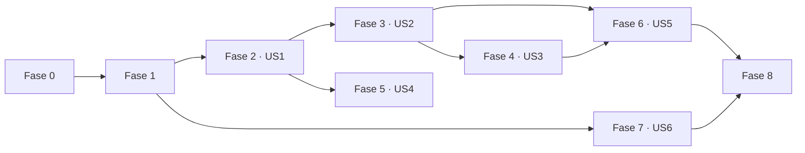

# Tasks 001: MVP "first bite" (v0.1)

**Entradas:** [`spec.md`](spec.md) · [`plan.md`](plan.md) · [`research.md`](research.md) · [`contracts/`](contracts/)

## Formato

`- [ ] T### [P?] [US?] Descrição — caminho (FR cobertos)`

- **[P]**: pode rodar em paralelo, porque mexe em arquivos diferentes e não depende de tarefa pendente.
- **[USn]**: a história de usuário atendida.
- **Teste primeiro:** em cada fase, as tarefas de teste vêm antes e **precisam falhar** antes da implementação.
- Ao concluir uma tarefa, marque `[x]` e cite os FR no PR.

---

## Fase 0: Setup

- [ ] T001 Inicializar o módulo `github.com/morsel-dev/morsel`, criar a estrutura de pastas do plan §4 e a licença Apache-2.0 — raiz
- [ ] T002 [P] Configurar CI (GitHub Actions): `go vet`, `staticcheck`, `golangci-lint`, `go test -race`, build com `CGO_ENABLED=0` para 6 alvos — `.github/workflows/ci.yml`
- [ ] T003 [P] Configurar `goreleaser` (binários, checksums, tap do Homebrew) — `.goreleaser.yaml`
- [ ] T004 [P] Esqueleto da CLI com cobra: `serve`, `init`, `query`, `stats`, `bench`, `calibrate`, `version` — `cmd/morsel/`
- [ ] T005 **Experimento:** verificar se subagentes do Claude Code compartilham a sessão MCP do agente principal; registrar o resultado em `research.md` (R11) e resolver o `[NEEDS CLARIFICATION]` da spec — `specs/001-mvp/` (FR-021)

## Fase 1: Fundação (bloqueia todas as histórias)

### Testes
- [ ] T006 [P] Testes da config: padrões seguros, expansão de `${VAR}`, validação de limites — `internal/config/config_test.go`
- [ ] T007 [P] Testes de segurança da fonte fs: `../`, caminho absoluto, symlink para fora da raiz, `.env`, `id_rsa`, `*.pem`, `.gitignore`, binário → `denied` ou metadados — `internal/source/fs/fs_test.go` (FR-025, FR-026, FR-027)
- [ ] T008 [P] Testes do tokenizer: monotonicidade, `ratio` por tipo, erro dentro de ±15% no corpus `testdata/calib/` — `internal/tokenizer/tokenizer_test.go` (FR-016, SC-002)
- [ ] T009 [P] Testes do envelope: ordem de chaves, omissão de vazios, validação contra `envelope.schema.json`, mesmos bytes em 100 execuções — `internal/envelope/envelope_test.go` (FR-029)
- [ ] T010 [P] Fuzz do parser: nenhuma entrada causa pânico — `internal/query/fuzz_test.go`
- [ ] T011 [P] **Teste de contrato:** o schema embutido é igual a `contracts/schema.graphql` — `internal/query/contract_test.go` (FR-002)
- [ ] T012 [P] **Teste de contrato:** as três ferramentas, com nomes, schemas e descrições idênticos a `contracts/mcp-tools.md`; soma das descrições < 450 tokens — `internal/server/contract_test.go` (FR-028)

### Implementação
- [ ] T013 [P] `config`: tipos, carga TOML, padrões, expansão — `internal/config/` (FR-015)
- [ ] T014 [P] Fonte fs: confinamento via `os.Root`, lista de negação, gitignore, detecção de binário (sniff de 8 KB + NUL), tabela de offsets de linha — `internal/source/fs/` (FR-025–027)
- [ ] T015 [P] Interface `Tokenizer` + heurística com `ratio` embutido — `internal/tokenizer/` (FR-016)
- [ ] T016 [P] Encoder determinístico do envelope — `internal/envelope/` (FR-029)
- [ ] T017 Parse e validação com gqlparser contra o schema embutido; sugestões por distância de Levenshtein — `internal/query/` (FR-001, FR-003)
- [ ] T018 Pantry (LRU por bytes) + loader (singleflight por `ID@Version`) — `internal/pantry/`, `internal/loader/` (FR-023, FR-024)
- [ ] T019 Servidor MCP via stdio com as três ferramentas registradas (handlers retornam `internal` até as fases seguintes) — `internal/server/` (FR-028)

**Checkpoint:** `morsel serve` sobe, lista as 3 ferramentas e os testes de contrato passam.

## Fase 2: US1, consultar só o necessário (P1) 🎯

### Testes
- [ ] T020 [P] [US1] Repositório de teste `testdata/repo/` (3 pacotes, método com receptor, arquivo gerado, arquivo com erro de sintaxe, nome de símbolo duplicado) — `internal/exec/testdata/`
- [ ] T021 [P] [US1] Golden files para os 4 cenários de aceitação da US1, mais `outline` e `imports` — `internal/exec/us1_test.go` (FR-004–006, FR-008)
- [ ] T022 [P] [US1] Testes do índice gosym: tipos de símbolo, assinatura, doc, offsets do corpo, `callers`/`callees` com `approx`, reindexação após mudança de arquivo, `stale` — `internal/source/gosym/gosym_test.go` (FR-007–010)

### Implementação
- [ ] T023 [US1] Índice gosym: parse por pacote, varredura paralela, mapa de chamadas, revalidação por `mtime+size` — `internal/source/gosym/` (FR-007, FR-009, FR-010)
- [ ] T024 [US1] Executor + resolvers `file`, `files`, `symbol`, `symbols`, `ref`; projeção estrita dos campos; ordenação estável — `internal/exec/` (FR-002, FR-004, FR-005)
- [ ] T025 [US1] Campos de arquivo: `lines(from,to)`, `outline`, `imports`, `generated`, `binary` — `internal/exec/file.go` (FR-006)
- [ ] T026 [US1] Integrar `morsel_query` e `morsel query` (CLI) ao executor — `internal/server/`, `cmd/morsel/query.go` (FR-034)

**Checkpoint:** US1 completa e demonstrável via `morsel query`.

## Fase 3: US2, orçamento de tokens (P1) 🎯

### Testes
- [ ] T027 [P] [US2] Teste de propriedade: para consultas e orçamentos aleatórios, `act ≤ budget` ou `over_budget` — `internal/plan/budget_prop_test.go` (FR-013)
- [ ] T028 [P] [US2] Cenários de aceitação da US2: brief automático, paginação, corte da maior folha, `over_budget` com `breakdown`, `@budget` com teto — `internal/plan/us2_test.go` (FR-011, FR-014, FR-015)

### Implementação
- [ ] T029 [US2] Estimador por campo, sem materializar (tabela do plan §5.2) — `internal/plan/estimate.go` (FR-012)
- [ ] T030 [US2] Budget fitting determinístico (plan §5.3) + `truncated` com bites sugeridas — `internal/plan/fit.go` (FR-014)
- [ ] T031 [US2] Guard pós-serialização (pipeline, passo 8) + `cost` no envelope — `internal/exec/guard.go` (FR-011, FR-013)

**Checkpoint:** nenhuma resposta excede o orçamento; o envelope sempre traz o custo.

## Fase 4: US3, crumbs (P2)

### Testes
- [ ] T032 [P] [US3] Cenários de aceitação 1 a 5 da US3 + expiração por consultas e por TTL + `min_tokens` — `internal/crumbs/crumbs_test.go` (FR-017–022)

### Implementação
- [ ] T033 [US3] Ledger de entregas por consumer, chave `(consumer, id, field, version)`, expiração — `internal/crumbs/` (FR-017, FR-021, FR-022)
- [ ] T034 [US3] Crumbify no executor + descritores (plan §6) — `internal/exec/crumbify.go` (FR-018, FR-019)
- [ ] T035 [US3] `morsel_expand` — `internal/server/expand.go` (FR-020)

## Fase 5: US4, descoberta do schema (P2)

- [ ] T036 [P] [US4] Testes: visão geral < 600 tokens, busca por "callers" retorna o caminho desde a raiz, sugestão para campo inválido — `internal/query/schema_test.go`
- [ ] T037 [US4] SDL minificado + busca por nome e descrição — `internal/query/minify.go`, `internal/server/schema.go`

## Fase 6: US5, ver a economia e provar a tese (P3) ⚖️

### Testes
- [ ] T038 [P] [US5] Testes do ledger: baseline ingênuo conforme plan §7, soma por sessão, persistência sem conteúdo — `internal/ledger/ledger_test.go` (FR-030)
- [ ] T039 [P] [US5] testscript de `morsel stats` (rótulo de "estimativa" presente) — `cmd/morsel/testdata/stats.txtar` (FR-031)

### Implementação
- [ ] T040 [US5] Escolher e fixar o repositório fixture (Go, 30k–150k linhas, testes rodando com `go test`), registrando o motivo — `bench/fixtures/fixture.lock`
- [ ] T041 [US5] Escrever 8 tarefas de benchmark (3 de entendimento, 3 de correção de bug com teste quebrado, 2 de extensão), com `verify` objetivo — `bench/tasks/`
- [ ] T042 [US5] Ledger + `cost.saved` + `morsel stats` — `internal/ledger/`, `cmd/morsel/stats.go` (FR-030, FR-031)
- [ ] T043 [US5] Runner A/B (clones isolados, execuções alternadas, coleta de uso via saída JSON do agente) + relatório em md e json — `internal/bench/`, `cmd/morsel/bench.go` (FR-033)
- [ ] T044 [US5] ⚖️ **Rodar o benchmark e registrar o resultado em `bench/results/`. Decisão sobre H1 (VISION §7): seguir, ajustar ou parar.**

## Fase 7: US6, começar em 5 minutos (P3)

- [ ] T045 [P] [US6] testscript de `morsel init`: cria `morsel.toml`, adiciona o snippet sem sobrescrever, é idempotente — `cmd/morsel/testdata/init.txt` (FR-032)
- [ ] T046 [US6] Implementar `morsel init` com o snippet de `contracts/mcp-tools.md` — `cmd/morsel/init.go` (FR-032)

## Fase 8: Polimento

- [ ] T047 [P] Lint customizado: proibir iteração sobre `map` sem ordenação em `internal/envelope` e `internal/exec` — `tools/lint/`
- [ ] T048 [P] Benchmark Go de latência (SC-001) num repositório sintético de 5 mil arquivos — `internal/exec/perf_test.go`
- [ ] T049 [P] `morsel calibrate`: recalcular os `ratio` com a API de contagem do provedor (opcional, chave do usuário) — `cmd/morsel/calibrate.go` (R5)
- [ ] T050 [P] Atualizar o README com o resultado **real** do benchmark (ou retirar a promessa) — `README.md` (constituição VII)
- [ ] T051 Gravar a demo de tela dividida (só depois de T044) — `assets/demo/`
- [ ] T052 Release v0.1.0 + post de lançamento — tag

---

## Dependências

- T005 precisa terminar **antes** da T033.
- A T044 é o **portão de decisão** do projeto: as specs 002+ só começam depois dela.
- As Fases 5 e 7 podem andar em paralelo com as Fases 3 e 4 se houver mais de uma pessoa (ou agente).

## Rastreabilidade (FR → tarefas)

| FR | Tarefas | FR | Tarefas |
|---|---|---|---|
| 001 | T017 | 018 | T034 |
| 002 | T011, T024 | 019 | T034 |
| 003 | T017 | 020 | T035 |
| 004 | T021, T024 | 021 | T005, T033 |
| 005 | T024 | 022 | T033 |
| 006 | T025 | 023 | T018 |
| 007 | T023 | 024 | T018 |
| 008 | T021 | 025 | T007, T014 |
| 009 | T022, T023 | 026 | T007, T014 |
| 010 | T023 | 027 | T007, T014 |
| 011 | T028, T031 | 028 | T012, T019 |
| 012 | T029 | 029 | T009, T016, T047 |
| 013 | T027, T031 | 030 | T038, T042 |
| 014 | T028, T030 | 031 | T039, T042 |
| 015 | T013, T028 | 032 | T045, T046 |
| 016 | T008, T015 | 033 | T043 |
| 017 | T032, T033 | 034 | T026 |
