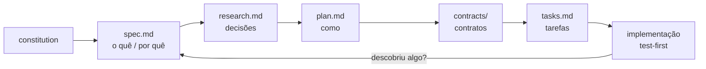

# Specs: como o Morsel é construído (SDD)

O Morsel segue **Spec-Driven Development (SDD)**: a especificação é a fonte da verdade, e o código é consequência dela. Isso vale para humanos e também para agentes de código. Um agente que implementa uma tarefa recebe a spec, não uma conversa solta.

## Estrutura

```
specs/
├── README.md                  ← este arquivo (o processo)
├── constitution.md            ← princípios inegociáveis (vale para todas as features)
└── 001-mvp/                   ← uma pasta por feature, numerada
    ├── spec.md                ← O QUÊ e POR QUÊ (sem tecnologia)
    ├── research.md            ← decisões técnicas e alternativas descartadas
    ├── plan.md                ← COMO (arquitetura, pacotes, algoritmos)
    ├── contracts/             ← contratos verificáveis (schema, ferramentas, envelope)
    │   ├── schema.graphql
    │   ├── mcp-tools.md
    │   └── envelope.schema.json
    └── tasks.md               ← tarefas ordenadas, rastreáveis até os requisitos
```

## O fluxo



1. **Constituição.** Ela é lida antes de tudo. Qualquer plano que viole um princípio precisa justificar a exceção na seção *Constitution Check* do `plan.md`.
2. **Spec.** Histórias de usuário com prioridade, cenários de aceitação (Dado/Quando/Então), requisitos funcionais numerados (`FR-xxx`) e critérios de sucesso mensuráveis (`SC-xxx`). **Não menciona tecnologia.** Dúvidas ficam marcadas como `[NEEDS CLARIFICATION]`.
3. **Research.** Cada decisão técnica relevante registra: decisão, motivo e alternativas descartadas.
4. **Plan.** Arquitetura, layout de pacotes, modelo de dados, algoritmos e estratégia de testes.
5. **Contracts.** Artefatos que o código **precisa** satisfazer e que viram testes: o schema GraphQL, o contrato das ferramentas MCP e o JSON Schema do envelope.
6. **Tasks.** Lista ordenada com IDs (`T001`), marcação de paralelismo (`[P]`), história de usuário (`[US1]`) e requisitos cobertos. **Os testes vêm antes da implementação.**
7. **Implementação.** Cada PR referencia as tarefas e os `FR` que implementa.

## Regras do jogo

- **Mudou o comportamento? Mude a spec primeiro.** PRs com comportamento novo sem mudança de spec são recusados.
- **Toda tarefa é rastreável:** tarefa → FR → história de usuário → visão.
- **Nada de `[NEEDS CLARIFICATION]` aberto** em requisito de uma história que está sendo implementada.
- **Os contratos são testes.** Se o contrato muda, os testes de contrato mudam no mesmo PR.

## Trabalhando com agentes de código

Para implementar uma tarefa com Claude Code, Codex ou similares, use este prompt:

```
Leia specs/constitution.md e specs/001-mvp/{spec,plan}.md e os contratos.
Implemente a tarefa T0XX de specs/001-mvp/tasks.md.
Comece pelo teste. Não implemente nada fora do escopo da tarefa.
Ao terminar, marque a tarefa como [x] e liste os FR cobertos.
```

Esse formato mantém o agente no trilho e torna o próprio desenvolvimento do Morsel um caso de uso de **contexto enxuto**.

## Próximas features (ainda sem spec)

| Pasta | Feature | Versão |
|---|---|---|
| `002-upstream-mcp` | Proxy de servidores MCP upstream com projeção | v0.2 |
| `003-persistent-pantry` | Cache persistente entre sessões | v0.2 |
| `004-postgres` | Fonte Postgres (schema, amostras, consultas somente leitura) | v0.3 |
| `005-multilang-symbols` | Símbolos multilinguagem (tree-sitter) | v0.3 |
| `006-recipes` | Bites persistidas e nomeadas | v0.3 |
| `007-daemon` | Daemon HTTP compartilhado entre agentes e sessões | v0.4 |
