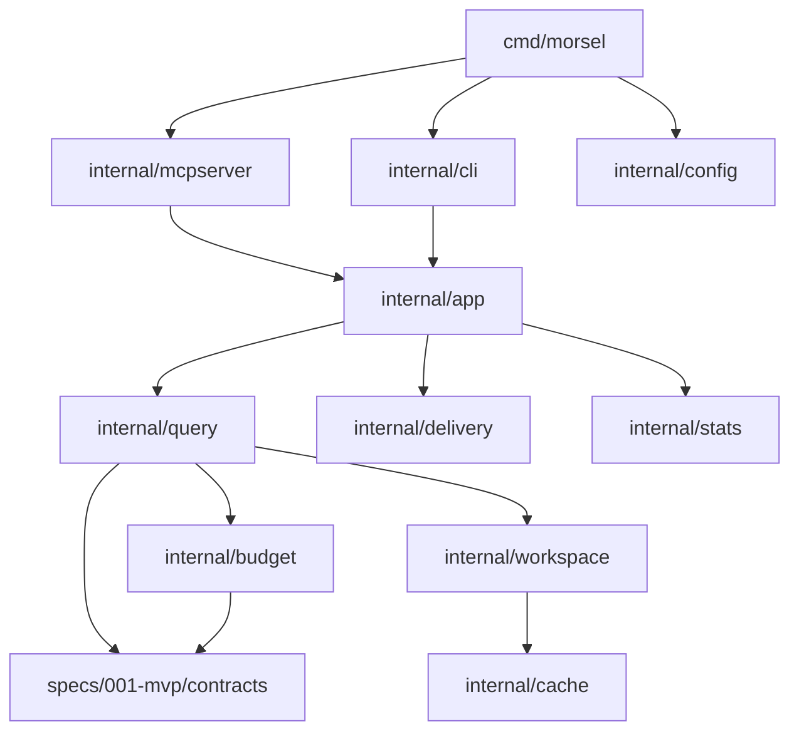

# Arquitetura do Morsel

Estado: desenho para v0.1, sem implementação. Autoridade: [constituição](../specs/constitution.md), [MVP](../specs/001-mvp/spec.md) e [contratos](../specs/001-mvp/contracts/protocol.md).

## Estrutura e dependências

Um processo Go por conexão stdio. Composição em `cmd/morsel`, sem singleton ou service locator. O grafo mostra imports permitidos, não a ordem de chamadas.

| Pacote planejado | Responsabilidade | Não deve conhecer |
|---|---|---|
| `cmd/morsel` | Construção, sinais e exit code | Resolução de campos |
| `internal/cli` | Flags, init, saída de terminal | SDK MCP |
| `internal/mcpserver` | SDK, argumentos, três tools, stdio | AST Go e arquivos-fonte |
| `internal/app` | Sessão, consulta, finalização, entrega | SDK MCP e cobra |
| `internal/query` | Perfil GraphQL, plano, projeção e resolvers | TOML, stdout e persistência |
| `internal/workspace` | Política, snapshots, arquivos e índice Go | MCP, GraphQL e consumidor |
| `internal/cache` | LRU por bytes e trabalho compartilhado | Autorização e entregas |
| `internal/budget` | Medidor, estimativa, redução e JSON final | SDK e filesystem |
| `internal/delivery` | Chaves e expiração por consumidor | Resolvers e fontes |
| `internal/stats` | Contadores e snapshots atômicos | Conteúdo de fontes e queries |
| `internal/config` | Defaults, TOML e validação | Serviços e estado global |
| `specs/001-mvp/contracts` | SDL/JSON via `go:embed`, tipos de wire | Pacotes `internal/` |

São fronteiras previstas, não pastas a criar vazias. Arquivos e símbolos começam em `workspace`, em arquivos separados. Extrair subpacote quando tamanho ou outra linguagem justificarem. Benchmark fica em `bench/`, sem importação pelo runtime.

## Regras de código

- Preferir tipos concretos e composição. Interfaces pequenas pertencem ao consumidor, para fronteiras testáveis ou múltiplas implementações necessárias. Sem `Source` genérico com dezenas de métodos.
- `context.Context` primeiro em I/O e trabalho caro. Preservar causas com `%w`; adaptadores traduzem códigos sem vazar caminhos absolutos.
- Snapshots são imutáveis. Não devolver slices ou mapas mutáveis do cache. Documentar dono e vida útil dos buffers; símbolos compartilham bytes por offsets.
- Configuração tipada antes de servir. Sem estado global mutável, goroutines sem dono ou I/O em `init()`.
- Locks protegem estado local, nunca I/O, serialização ou callbacks. Concorrência limitada, cancelamento e shutdown verificáveis.
- `gofmt`, nomes idiomáticos, comentários sobre invariantes. Evitar `utils`, `common`, `helpers` e camadas que só repassam chamadas.
- Injetar relógio em expiração e falhas nas fronteiras de I/O. Testar comportamento; não criar mocks para cada struct.

## Fluxo

1. Adaptador valida entrada. `app` resolve limites, prazo e namespace da conexão.
2. `query` seleciona operação, coage variáveis, expande fragments com limite e valida antes de acessar fontes.
3. `workspace` autoriza antes do cache e captura snapshots. Busca de símbolos captura manifesto coerente; mudança durante captura gera `source_changed`.
4. `query` prevê custo com metadados disponíveis. Leitura e indexação podem ser necessárias no caminho frio; não se promete zero leitura prévia.
5. Projeta campos. `delivery` propõe referências menores que o original, sem alterar estado.
6. `budget` finaliza bytes, corta com progresso estrito e prepara entregas somente dos valores completos presentes no resultado.
7. Após escrita bem-sucedida no transporte, `app` efetiva entregas e contadores. Falha/cancelamento descarta o conjunto. Isso confirma escrita, não consumo pelo modelo.

Não há transação distribuída: o cliente pode perder uma resposta já escrita. Reconexão cria namespace novo; `fresh` e `expand` recuperam conteúdo na conexão atual.

## Concorrência e crescimento

Snapshots incluem raiz, política e SHA-256. Cache nunca substitui autorização. Singleflight compartilha trabalho da mesma versão no processo, nunca histórico de entrega. Cancelar um waiter não cancela trabalho usado por outro; cancelar todos encerra o trabalho.

Limites independentes para bytes, profundidade, campos expandidos, itens, prazo, indexação, cache e consumidores estão na [M02](../specs/001-mvp/02-workspace/spec.md). Orçamento de saída não substitui esses limites.

Snapshot é coerente com bytes lidos, não uma transação do filesystem. Detectar mudanças durante captura e retornar erro recuperável; edição posterior pertence à próxima consulta. `mtime+size` otimiza descoberta, nunca prova igualdade.

Uma segunda fonte altera resolvers e composição após spec própria. Só extrair contrato entre fontes quando a segunda implementação provar o que é comum. Persistência exige compatibilidade/migração; daemon exige autenticação, namespaces e quotas. Imports são verificados por `go list -json`; wire por contratos e cliente MCP real.

## Referências verificadas em 2026-11-23

- [Organização de módulos Go](https://go.dev/doc/modules/layout): base para `cmd`/`internal`; os limites acima são decisão do projeto.
- [Traversal e os.Root](https://go.dev/blog/osroot), [limitações de Root](https://pkg.go.dev/os#Root): Root não é sandbox contra mounts/hardlinks ou alterações por outros processos.
- [SDK oficial Go](https://github.com/modelcontextprotocol/go-sdk), [stdio MCP 2025-11-25](https://modelcontextprotocol.io/specification/2025-11-25/basic/transports): fixar SDK e versões negociadas, sem seguir `main` automaticamente.
- [GraphQL September 2025](https://spec.graphql.org/September2025/): sintaxe/validação; saída com crumbs é perfil próprio descrito nos contratos.
